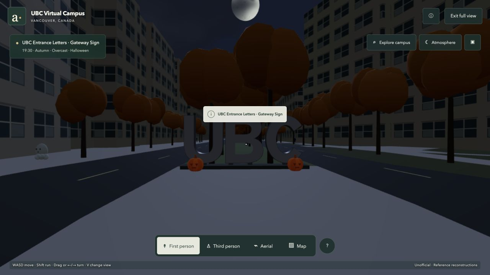

# UBC landmarks and Halloween — production receipt

Deployed and verified October 31, 2026 at **19:57:52 UTC / 12:57:52 Vancouver**.
Both [apex](https://asymmetri.co/labs/ubc) and
[www](https://www.asymmetri.co/labs/ubc) serve the release. The owner explicitly
authorized autonomous completion and deployment. Later documentation commits do
not change the running source or build.

## Exact release

| Item | Verified identity |
| --- | --- |
| Implementation | `05b600242227a0bd44d6ec8b0258573db51fc66b` |
| Candidate / running source | `8eba0e908c8e5c47c5ab46b82e868a6be754bdb5` |
| Linux Next build | `rtOqqaM__deGCW7i5raQm` |
| Linux workflow | [41234896204](https://github.com/eugenelin89/asymmetri/actions/runs/41234896204), successful attempt 1 |
| Artifact | `13055525238`, created 19:40:43 UTC |
| Node | Existing `v22.23.1`; server binary unchanged |
| ZIP SHA-256 | `10a169a2ed6101ead16ff9a054ea00b462f89fe97ad9b1765fa87e757de08527` |
| Runtime tar SHA-256 | `b8ebd372ca647780414627be5a806a4b5604d2d88b472c15f185919d297c6798` |
| Runtime tar size | 254,899,694 bytes; 899,615,111 uncompressed bytes |

The artifact's source, archive paths, links, checksums and Linux runtime were
verified before transfer. The server used an independent application-owned source
checkout and that exact runtime. There was no live compilation or Mac dependency
transfer. Local build `qwey2Xqf7rk9-KesME5qs` is separate validation evidence.

## Delivered experience

- Arrival now faces the large UBC letters at **University Boulevard and Wesbrook
  Mall**. Placement uses the official pedestrian island with estimated fine
  positioning; it is not a surveyed monument model.
- Beaty has a narrow glass pavilion, an original approximately 26 m suspended
  whale visible from Main Mall, descending ramps and a below-grade public gallery.
- Irving K. Barber has source-footprint architecture, heritage and modern wings,
  and interpreted public circulation and study spaces, including Chapman and
  Ridington. Beaty and Irving bring supported building interiors to **nine**.
- Ken Woods, Harry Warren and South Turf soccer fields, the eight-lane Rashpal
  Dhillon track and existing Thunderbird Stadium receive improved geometry.
  Twenty-four fictional soccer players and twelve track joggers provide activity.
- Halloween adds **29 spaced decoration sets across all nine interiors**, two
  gateway pumpkins and up to 19 route-bound outdoor creatures. Original ghosts,
  pumpkins, webs, a full moon and dark clouds form a reusable seasonal layer.

Halloween defaults on **October 31–November 6, 2026 inclusive**, using Vancouver
dates. Subsequent years use October 25–November 1. Visitors can switch
**Atmosphere → Halloween campus** on or off year-round; their explicit choice is
remembered on the device for the current year. Turning it off restores the prior
season, weather and time within that visit. Reduced motion freezes decorative
animation; population off hides outdoor creatures. The sky is theatrical rather
than a claim about actual weather or lunar phase.

The nine interiors are Rose Indoor Training Centre, Bookstore, AMS Nest, Sauder,
Hennings, War Memorial Gym, Orchard Commons, Beaty and Irving. All are **Level B
reference-based reconstructions**, not measured floor plans. Unknown/private
spaces are not claimed as verified. Virtual access does not imply real access.
Other campus areas retain mixed detail and the campus uses a mostly flat datum.

Architecture, layout, collision, movement and seasonal modules live in
`projects/ubc/`; `projects/ubc/Campus.tsx` owns visitor controls and
`app/labs/ubc/page.tsx` owns route composition. The only shared card changes are
the two UBC status/description strings in `content/site.ts`. Existing conversations,
encounter discovery, character sources, official links and public profiles remain
unchanged. No new person or biography was added in this release.

See the [implementation report](UBC_LANDMARKS_HALLOWEEN_2026-10-31.md),
[fidelity registry](../projects/ubc/landmark-fidelity.json),
[asset manifest](ASSET_MANIFEST.md) and
[third-party notices](../projects/ubc/THIRD_PARTY_NOTICES.md) for source URLs,
coordinate transformations, architecture and reconstruction limits. Published PDDL
GIS bytes are unchanged. All new geometry/textures are original procedural assets;
no external photograph, portrait, voice, model or official logo asset was imported.

## Validation

**Local:** 269 tests passed: UBC 99, Vancouver 74, Surrey 69 and Richmond 27.
TypeScript/ESLint, Next and Vinext builds passed; the existing tutorial-navigation
warning remains. Production dependency audit reported zero vulnerabilities.
Source/privacy and whitespace checks passed.

Actual desktop browser checks covered gateway arrival, the outside-visible whale,
Beaty entrance and both descending ramp flights, Irving entrance/stairs through
Level 3 and Chapman, a moving track jogger, aerial field markings, stadium stands
and a ghost inside Rose. Automated tests additionally cover floor traversal,
collision, exits, seasonal placement and repeated toggle lifecycle. Phone
390 × 844 and tablet 820 × 1180 viewports passed control/overflow checks, including
keyboard toggling and reduced-motion controls.

**Private Linux candidate:** 17 routes, 8 protected-host checks, 24 tutorial
assets and 124 legacy tutorial IDs passed. All 688 Richmond outputs and six UBC
assets matched, alongside preserved Vancouver/Surrey data. Native image
optimization returned HTTP 200. The new UBC page and exact two-string GIS card
change matched the reviewed source; other protected content/links/canonicals were
compared with the preceding live runtime. Existing opt-in profiles remained
available without exposing private fields.

**Public:** both hosts passed 17-route/24-tutorial-asset comparisons, followed by
70 additional route, redirect and geographic-asset checks. Four public profile
checks passed; no test profile was published. The external profile store and
configuration hashes remained unchanged, with directory/file modes 0700/0600.

**Live browser:** a fresh Start exploring action loaded the gateway at
19:30/autumn/overcast with Halloween automatically enabled. Keyboard Space turned
it off and restored 15:00/clear; turning it back on restored the Halloween scene.
The letters, pumpkins, moon and roaming ghost rendered. No console warnings or
errors were observed. One initial browser inspection timed out during loading;
the scene then loaded and responded normally. This is separate from local
walkthrough evidence and does not claim a fresh production tour of every interior.

The [gallery](validation/ubc-landmarks-halloween/README.md) contains this live
capture plus eight unretouched local captures. Physical-device testing and
comprehensive screen-reader acceptance remain outstanding. A local Irving
observation was approximately **12 FPS, 559 draw calls and 1.817 million triangles**
under concurrent validation load. It is not a sustained production benchmark or
evidence of achieving the target 60 FPS. Full photographic fidelity is not claimed.

## Health and recovery

Activation completed in approximately seven seconds. Final health at 19:58:14 UTC
confirmed the exact source/build, active/enabled website service with zero
restarts, unchanged Node binary, **five peer services**, **56 configuration
fingerprints** and **13 unrelated virtual hosts**. No post-activation errors were
recorded; the old runtime's expected shutdown exit 143 was distinguished from new
runtime errors. No DNS, TLS, Nginx, shared-service policy or profile configuration
was changed.

| Guard phase | Minimum available RAM (KiB) | Minimum free disk (bytes) |
| --- | ---: | ---: |
| Independent checkout | 489,148 | 7,738,167,296 |
| Linux artifact installation | 531,776 | 6,908,403,712 |
| Private smoke | 346,836 | 6,733,410,304 |
| Activation monitor | 384,692 | 6,733,385,728 |
| Final health | 418,684 | 6,733,152,256 |

The unchanged floors were **192 MiB available RAM / 6 GiB free disk**. All guards
passed. Continuous monitoring found no peer or capacity violation.

The complete immediate predecessor remains at
`/var/www/asymmetri-rollback-before-ubc-v04-landmarks-20261031`: source
`f3e5a9fd530ca3acd28f9f8200d6668e79c03273`, build `UvDOiPq9Ko5YmOkq4aC66`, including
executable dependencies and public assets. For rollback, recheck identities and
capacity, stop only `asymmetri.service`, preserve the failed runtime separately,
restore the complete predecessor, then repeat public/protected/profile checks.
Do not replace the external `/var/lib/asymmetri-ubc-community` store with an older
copy. Source-only or build-only rollback is insufficient.

## Historical retention

Three older inactive runtimes were losslessly archived to owner-held storage,
verified by SHA-256/gzip/identity and full GNU tar content/metadata comparison,
then their expanded duplicates were retired and server archive copies verified.
The third was needed because hard-linked older runtimes reclaimed less space than
their apparent size. Live and immediate rollback trees were never retirement
targets; capacity floors were not weakened.

| Archive basename | Source / build | Bytes | SHA-256 |
| --- | --- | ---: | --- |
| `asymmetri-rollback-before-surrey-v06-20261031` | `526213d` / `ujW5iepUV_ni0g_OH7ONo` | 405,606,400 | `7c688198707cc4d0db35493fed29aa377475cc0ea244f29945857b7af362f492` |
| `asymmetri-rollback-before-ubc-v032-encounters-20261031` | `5eb3c8a` / `fZHe4ybZDxYLvvS2CwwLm` | 405,452,800 | `e95067028223b23112ffb67cba13fd1920144d384dbea8fd74dc8f32bc9f5d7a` |
| `asymmetri-rollback-before-surrey-v06-guidance-20261031` | `f6fb80a` / `CM8fyU1dZ-i0htGXG2LZB` | 406,743,040 | `020d0ad97514cbf1842fdb2b4dce173d1fcaebcff4a1b0001fec2ad639905e7d` |

Their `.tar.gz` archives and receipts are under
`/var/lib/asymmetri-ubc-v04-landmarks-release-20261031`, with verified owner-held
copies in `~/dev/asymmetri/deployment-retention/2026-10-31/ubc-v04-landmarks`.
Three earlier archives from the V0.3.2/V0.3.3 receipts were also rehashed: six total.
The older expanded rollback `asymmetri-rollback-before-ubc-v033-dialogue-20261031`
remains at source `bbf194c`, build `Ds3XoQLPUe8czRrb_7rcW`. Activation and final
health rechecked all six archives and that complete older runtime. Historical
recovery requires checksum/identity verification and separate extraction retaining
ownership, ACLs and xattrs before activation.

Private evidence remains outside Git; no signed artifact URLs, profile records,
recovery credentials or runtime secrets are included here. The local preview was
used for acceptance; production availability is verified separately above.

## Next five priorities

1. Reduce interior frame time, draw calls and geometry, then measure sustained
   desktop and physical-phone performance.
2. Add verified terrain elevations, grades and accessible route continuity.
3. Improve landmark materials, facades, vegetation and sports details with licensed
   references and repeatable visual comparisons.
4. Obtain stronger public floor-plan evidence and refine interior stairs,
   collision and documented accessible circulation.
5. Expand contiguous detailed campus zones and repeat mobile, keyboard and
   screen-reader visitor journeys with refreshed official content.
