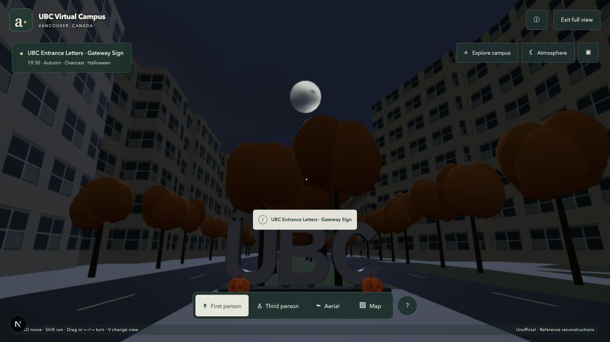
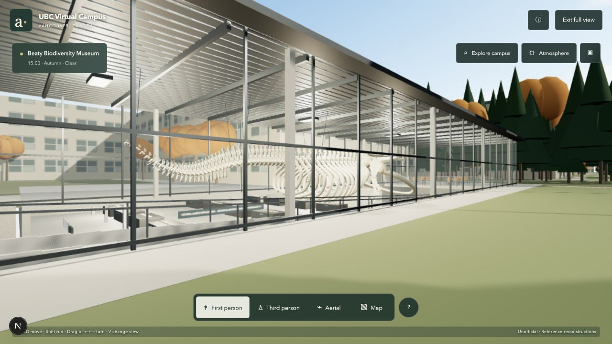
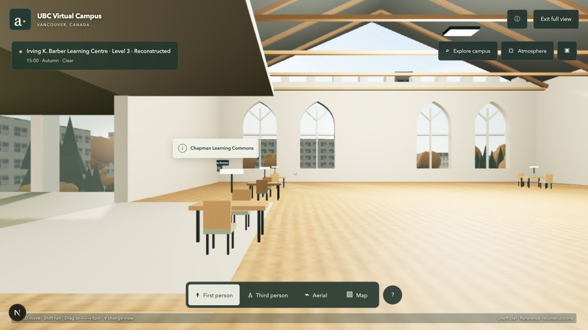
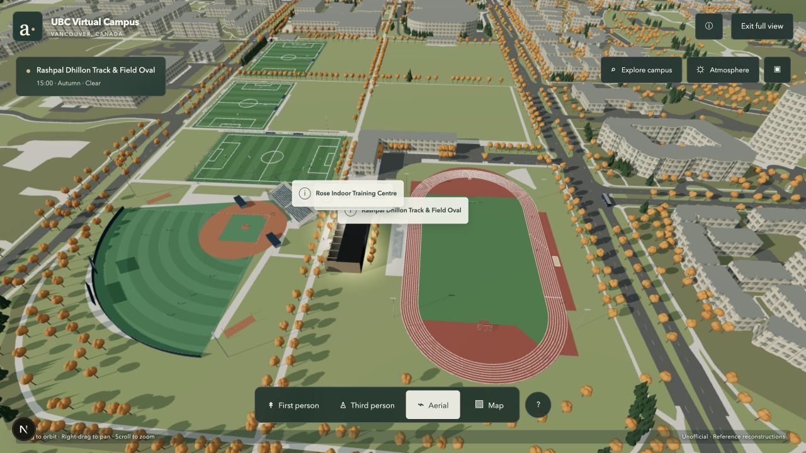
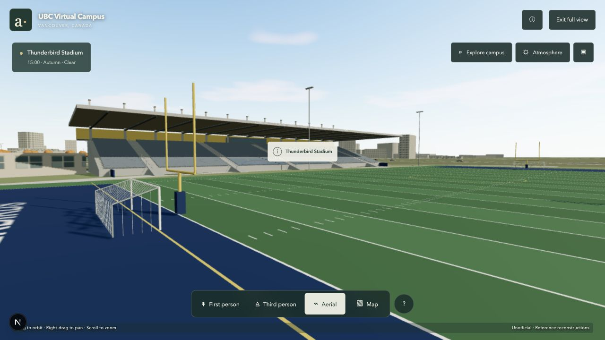
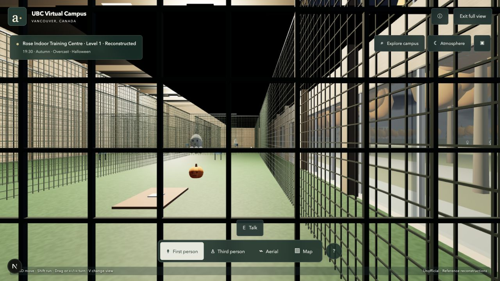
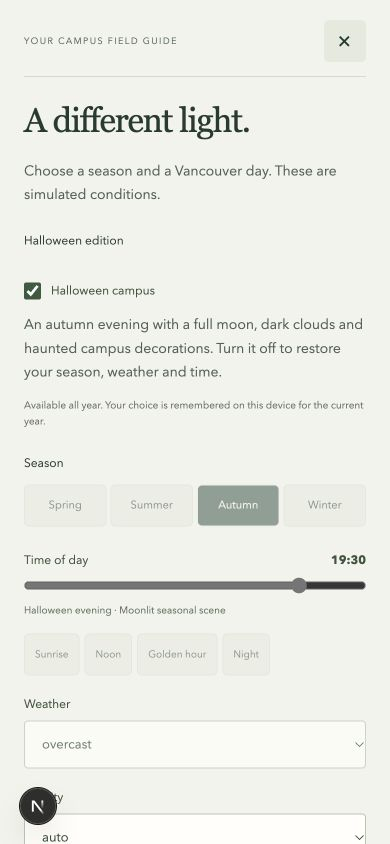
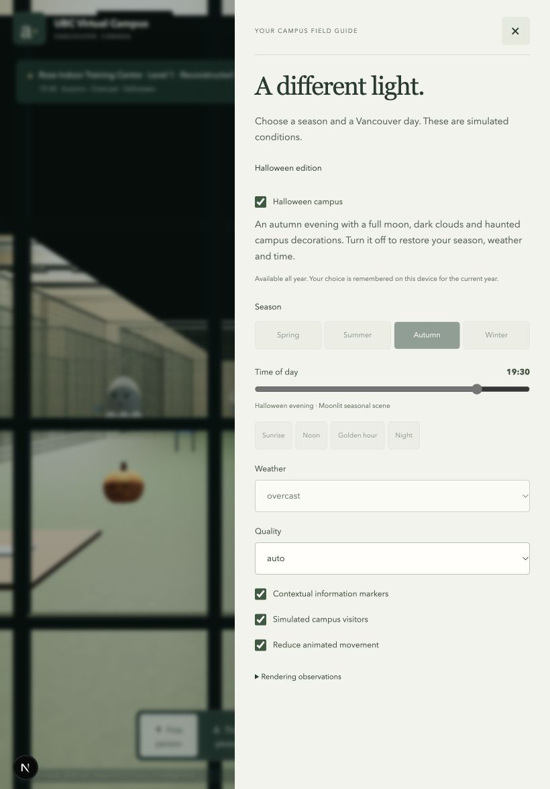

# Landmarks and Halloween browser evidence

Eight actual, unretouched JPEG captures of the local UBC Virtual Campus development
application at `/labs/ubc`, made on October 31, 2026. These are renderer/browser
captures, not generated marketing images, reference photographs or user attachments.
They document the candidate's rendered appearance; they are not a production-release
receipt. See the [implementation and validation report](../../UBC_LANDMARKS_HALLOWEEN_2026-10-31.md)
for functional checks, reconstruction limits and the observed performance limitation.

## Gateway arrival — 1280 × 720

The new pedestrian-island arrival, original silver letters, gateway pumpkins and
art-directed full moon. Nearby ambient creatures were also observed moving during
the browser walkthrough.

## Beaty from Main Mall — 1280 × 720

The original whale skeleton is visible through the glass pavilion. The separate
walkthrough entered the museum and descended both ramp flights; this exterior
capture alone is not evidence of that movement.

## Irving, Chapman space — 1280 × 720

The public-space reconstruction reached by walking through the entrance and up
the stairs to Level 3. Geometry and furnishings remain reference interpretations.

## Athletics overview — 1280 × 720

Final aerial view after the surface-paint rendering fix, with the Dhillon oval,
baseball precinct and soccer fields.

## Thunderbird Stadium grandstand — 1280 × 720

Actual browser view across the field toward the existing stadium's interpreted covered seating.
Automated navigation tests cover its stairs, public concourse and west grass bank.

## Rose Halloween interior — 1280 × 720

Original seasonal decorations inside the navigable training hall. The additive
overlay does not add solid obstacles to the normal interior.

## Phone controls — 390 × 844

Responsive browser viewport check: the Halloween toggle and explanatory controls
fit without horizontal overflow. The panel scrolls vertically for further options.

## Tablet controls — 820 × 1180

Responsive browser viewport check with the reduced-motion checkbox selected.
Automated tests verify that the overlay and cloud animation freeze. No physical
phone/tablet testing or sustained device-performance result is claimed.

## Production arrival — October 31, 2026

This ninth image is an unretouched **production** browser capture at 1280 × 720,
after activation of source `8eba0e9`, Linux build `rtOqqaM__deGCW7i5raQm`.
A fresh Start exploring action selected the scheduled 19:30 autumn/overcast
Halloween atmosphere. Keyboard Space switched it off to 15:00/clear and back on.
No console errors or warnings were observed. See the
[production receipt](../../UBC_LANDMARKS_HALLOWEEN_RELEASE_2026-10-31.md).
