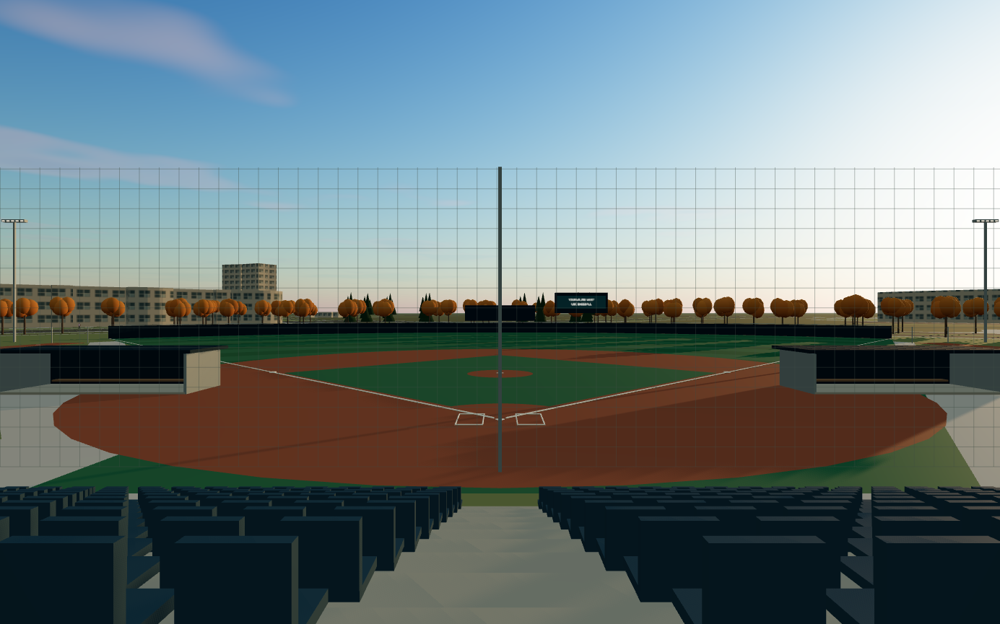
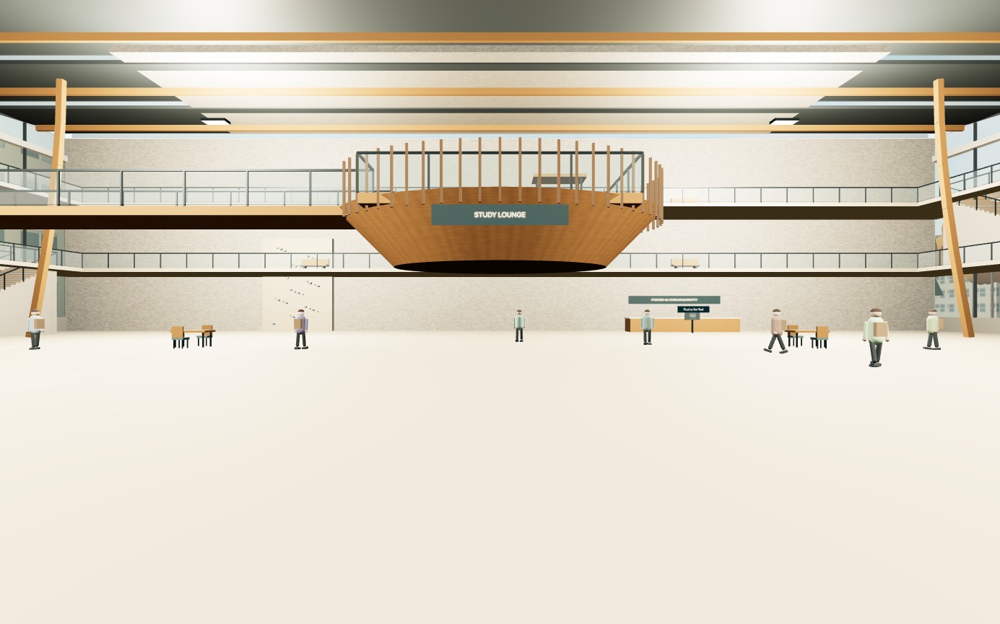

# UBC browser validation — October 30, 2026

These are real captures from the local `/labs/ubc` application, not concept artwork
or photographs of UBC. All architecture is a Level B interpretation. The complete
[implementation report](../../UBC_IMPLEMENTATION_2026-10-30.md) records source,
licensing, coverage and remaining acceptance limits.

The computer-use connection initially remained disabled after the user's settings
change. Resetting the connection exposed the in-app browser and allowed validation.
No production deployment was performed.

## Evidence

PNG files are unmodified WebGL exports generated by the application's photo control
and read from its visible image preview. They contain no interface or debug overlay.
JPEGs are computer-use browser screenshots, sometimes including in-app viewport
padding and the Next development indicator. The [manifest](manifest.json) lists
all 25 captures, dimensions, bytes, hashes and rights.

| Evidence | What it demonstrates |
| --- | --- |
| [West 16th start](01-west-16-spawn.png) | Rendered source-position pedestrian start looking toward the baseball precinct |
| [Rose training hall](02-rose-interior.png) | Walked through the entrance; net cages, pitching equipment, timber and lights |
| [Bookstore](03-bookstore-interior.png) | Walked through the entrance and along the shelf aisle; representative retail fixtures |
| [Rendering observations](04-rendering-observations.jpg) | Final Auto snapshot near Sauder: 60 FPS, 513 calls, 1,740,385 triangles |
| [Nest atrium](05-nest-atrium.png) | Revised central envelope, timber lounge and public circulation |
| [Nest upper gallery](06-nest-upper-gallery.png) | Both stair flights were traversed in the browser to reach level 3 |
| [Werker response](07-werker-conversation.jpg) | Sourced Operations Research answer and follow-up controls |
| [Unsupported question](08-werker-unsupported-question.jpg) | Private-opinion request receives a source-linked refusal |
| [President response](09-president-conversation.jpg) | Curated international-student information, without admissions promises |
| [President character](10-president-guide.png) | Original stylized simulation near the Nest, with no photorealistic likeness |
| [Map route](11-campus-map-route.jpg) | Connected GIS pedestrian route from the central campus toward the stadium |
| [Home plate](12-stadium-home-plate.png) | Walked onto the field; corrected upward normals and field shadowing |
| [Golden-hour field](13-stadium-golden-hour.png) | Vancouver date-dependent golden-hour preset |
| [Grandstand](14-stadium-grandstand.png) | Reached the platform through the side stair ramp and walked toward the centre |
| [Night stadium](15-stadium-night.png) | Lit field and darkened surrounding campus |
| [Snowy winter](16-winter-snow-aerial.png) | Selectable snow, source landscape/roof/tree material changes and aerial view |
| [Rainy winter](17-vancouver-rainy-winter.png) | Winter without permanent snow, rain/fog and wet material response |
| [Spring](18-spring-aerial.png), [summer](18-summer-aerial.png), [autumn](18-autumn-aerial.png) | Independently selectable seasonal vegetation; evergreen and deciduous materials remain separate |
| [Sauder exterior](19-sauder-exterior.png), [lobby](20-sauder-lobby.png) | Exterior arrival, walk-through entrance and supported lobby |
| [Mobile information](21-mobile-directory.jpg) | 390 CSS-pixel layout, searchable directory and Bookstore information |
| [Tablet study panel](22-tablet-study-panel.jpg) | AMS study information, official link and initial keyboard focus |
| [Werker at Sauder](23-werker-at-sauder.png) | Guide pauses and faces the approaching visitor |

## Browser checks and repairs

- Rose and Bookstore: enter, walk inside and return outside. Sauder: enter lobby.
- Nest: enter the atrium, climb the first stair flight, cross the gallery and climb
  the second flight. Both supported upper floors are reached; full descent/exit is
  separately covered by automated continuous-collision tests.
- Stadium: enter along the side, walk to home plate, climb the grandstand stair and
  cross the upper platform. Automated tests additionally traverse mound, dugout,
  bullpen and exit routes.
- Both named guides: find, see name/character, activate with E and select a grounded
  answer. Werker free text rejects unsupported personal opinions. Answers scroll
  into view, while source links and session history remain available.
- Directory filtering, connected map route, aerial/walk switching, direct 3D Nest
  selection, Bookstore apparel display and Nest study display worked.
- Atmosphere: four seasons, golden hour, night, rainy winter and snow exercised.
  Quality Low/Auto, reduced-motion and marker switches exercised.
- Responsive views: actual DOM widths/heights 390 × 844, 767 × 1024 and 1440 × 900;
  document width matched the viewport. A deliberately narrower 300-pixel probe
  encountered the shared site's 320-pixel minimum width. On-screen movement hold,
  search, Escape close and initial modal Tab focus worked. No physical phone or
  screen-reader certification is implied.
- Final captured browser error/warning list was empty. The original removed
  PCFSoftShadowMap and eager-image warnings were fixed.

The walkthrough uncovered and fixed exterior arrivals facing the wrong way,
duplicate directory polygon entries, the Nest envelope overlapping the Alumni
Centre, ten trees intruding into model envelopes, guides leaving visitors behind,
answers outside the panel viewport, duplicate signs and field shadow striping.
The immutable source data was not rewritten to hide these reconstruction issues.

## Performance and remaining limits

Final Auto observation near Sauder at 1440 × 900 CSS pixels: 60 FPS, 513 draw calls,
1,740,385 triangles. A Low-setting transition observation read 31 FPS, 304 calls,
712,531 triangles. Both were instantaneous samples with the settings panel open;
they do not establish sustained movement performance, frame-time percentiles or
mobile capability. Browser zoom affects the viewport override, so dimensions above
were read from the DOM rather than assumed from the requested override size.

The in-app browser did not expose a new destination tab after an external faculty
link click. The campus remained in place, HTTPS destinations were verified during
research and the rendered links have `noopener noreferrer`. End-to-end new-tab
testing in ordinary browsers remains open. PNG preview generation was verified;
native download handling varies by browser and was not certified here.

The scene is still visibly procedural. Exact architectural proportions, terrain,
high-fidelity trees/people, full snow coverage on bespoke assets, Main Mall close-up
evidence and comparison against licensed/current references remain unfinished.
These captures establish a working research preview, not the flagship V2 visual
standard or real-world access to any facility.
